# Plan de independización de Domicilios y WhatsApp

## Objetivo

Dejar Mesas, Cocina y Transferencias con su comportamiento actual, y construir dentro del mismo sistema una operación de domicilios independiente en datos, caja, permisos, pantallas e historial. WhatsApp será el puesto de trabajo principal de las gestoras; Despachos será el puesto de trabajo del despachador.

La separación no requiere duplicar productos, clientes ni infraestructura. El catálogo, las estaciones, los usuarios, PostgreSQL, Railway y los eventos en tiempo real se comparten. Cada pedido debe quedar marcado y consultado por su canal operativo.

## Avance implementado — entrega 1

- Se eliminó por completo el envío masivo de WhatsApp del panel, la API, el servicio y los scripts auxiliares.
- Los chats se actualizan por una sala Socket.IO exclusiva para administradores, cajeros y gestoras de domicilios.
- El estado visible de WhatsApp refleja la conexión Socket.IO real en escritorio y móvil: conectado, reconectando o sin conexión.
- La toma de una conversación es atómica: si dos gestoras intentan tomarla, solo una obtiene la asignación y la otra ve quién la está atendiendo.
- El historial de mensajes se carga en bloques de 120 con cursor para evitar descargar conversaciones completas.
- La bandeja de conversaciones también pagina por cursor estable; los chats nuevos no desplazan páginas ni causan saltos o duplicados al cargar más.
- Las respuestas atrasadas de búsquedas o filtros se descartan, y una reconexión conserva la consulta que la gestora está usando.
- Cambiar rápidamente de chat descarta respuestas atrasadas; el historial usa fecha e identificador para no omitir mensajes simultáneos.
- Abrir un chat solo envía confirmación de lectura para mensajes realmente pendientes; ya no repite todo el historial contra Meta.
- Las búsquedas y el historial de cliente iniciados desde WhatsApp excluyen pedidos de mesa (`LOCAL`).
- La pantalla de WhatsApp usa toda la altura y ancho disponibles, con una barra superior compacta y comportamiento móvil de bandeja/conversación.
- Se agregaron índices de PostgreSQL para bandeja, asignaciones, mensajes y conteos de lectura.

## Avance implementado — entrega 2

- `CashRegister` distingue caja general, salón y domicilios; la caja existente cuyo nombre contiene “Domicilios” se clasifica automáticamente sin modificar las demás.
- Cada pedido nuevo guarda `cashClosingId`, el turno exacto que lo recibió. Si existe Caja Domicilios, los pedidos `DELIVERY` y `PICKUP` requieren que esté abierta.
- Los resúmenes y detalles de Caja Domicilios consultan solo pedidos enlazados a ese turno y excluyen pedidos `LOCAL` y pedidos huérfanos.
- Abrir una caja ya no libera globalmente los chats asignados; varias gestoras pueden conservar sus conversaciones mientras operan otros turnos.
- El rol Gestora de Domicilios queda enfocado en WhatsApp, creación e historial comercial. Se añadió el rol Despachador de Domicilios para despachos, rutas, cobro, reimpresión e historial de domiciliarios.
- La creación de usuarios acepta roles personalizados activos y deja de convertir silenciosamente un rol desconocido en cajero.
- La API aplica los permisos efectivos del usuario en WhatsApp, pedidos, despachos, domiciliarios, clientes, cajas y usuarios; los roles personalizados reciben los mismos controles que los roles del sistema.
- La pantalla de cajas permite configurar el canal y muestra una insignia visible para evitar abrir o cerrar la caja equivocada.
- Al entregar un domicilio en efectivo, el pago queda como `DRIVER_CASH_PENDING`; ya no se contabiliza como dinero recibido en caja.
- Domiciliarios muestra cuánto debe entregar cada repartidor y permite liquidar juntos los pedidos de su turno, registrando esperado, recibido, diferencia, responsable y nota.
- La Caja Domicilios muestra el efectivo que sigue en calle y bloquea el cierre mientras exista una liquidación pendiente.

## Avance implementado — entrega 3

- Cada conversación de WhatsApp conserva su propio borrador de pedido: productos, cliente, dirección, barrio, tarifa, ubicación y forma de pago sobreviven una recarga sin mezclarse con otro chat.
- Cada intento de creación envía una clave única persistida con el borrador. Reintentar después de mala señal o doble clic devuelve el mismo pedido en vez de crear otro.
- Una respuesta repetida del servidor no vuelve a imprimir la comanda.
- Los borradores de chats abandonados vencen a los siete días y se conservan como máximo veinte para no acumular basura en el dispositivo.
- Al confirmar o cancelar la toma del pedido, la gestora regresa a la misma conversación y conserva el contexto del cliente.
- El interruptor técnico del chatbot se administra desde Configuración SuperAdmin; dejó de ocupar espacio y de permitir cambios accidentales en la cabecera diaria de WhatsApp.

## Diagnóstico del código actual

1. `Order` ya distingue `DELIVERY`, `PICKUP` y `LOCAL`, pero `GET /orders`, las estadísticas del historial y varias búsquedas no aplican ese filtro. Por eso Historial Domicilios muestra pedidos de mesa.
2. `Order` tiene `cashRegisterId`, pero no queda enlazado directamente al turno de caja que lo recibió. Algunas consultas incluyen pedidos con caja nula, lo que puede mezclar ventas entre cajas.
3. WhatsApp ya recibe mensajes, muestra multimedia, asigna conversaciones, relaciona un chat con un pedido y actualiza por Socket.IO. Esa base sirve, pero `ChatPage.tsx` concentra demasiadas responsabilidades y supera ampliamente el tamaño razonable de una pantalla mantenible.
4. La matriz de permisos existe en el cliente, pero el servidor protege muchos endpoints solo con una lista de roles. Hoy varios permisos finos ocultan botones sin bloquear realmente la acción en la API.
5. La pantalla permite roles personalizados, pero el backend convierte cualquier código no incluido en su lista fija a `CASHIER`. Así no se puede crear todavía un despachador independiente de verdad.
6. Las estaciones ya se configuran por categorías y cocineros. La impresión también admite varias impresoras por categorías. Falta definir para cada estación qué canales recibe y si su salida es impresión, tablet o ambas.
7. La cola de impresión solo guarda `impreso: sí/no`. Falta deduplicación, intentos, error y limpieza automática para evitar duplicados y acumulación.
8. Marcar un domicilio como entregado puede confirmar el pago en efectivo. Operativamente, entregar el pedido y entregar el dinero en caja son hechos distintos.

## Flujo operativo propuesto

```mermaid
flowchart LR
    A[Mensaje de WhatsApp] --> B[Cola de atención]
    B --> C[Gestora toma el chat]
    C --> D[Borrador de pedido en panel lateral]
    D --> E[Confirmar pedido]
    E --> F[Caja de Domicilios abierta]
    E --> G[Estaciones por categoría]
    G --> H[Comanda impresa o tablet]
    H --> I[Pedido listo]
    I --> J[Despachador asigna domiciliario]
    J --> K[En ruta]
    K --> L[Entregado al cliente]
    L --> M{Forma de pago}
    M -->|Transferencia validada| N[Venta conciliada]
    M -->|Efectivo| O[Dinero pendiente del domiciliario]
    O --> P[Liquidación al regresar]
    P --> N
    N --> Q[Cierre de Caja Domicilios]
```

### Estados separados

No conviene seguir usando un solo estado para cocina, reparto y dinero. Se conservará el campo actual durante la transición, pero la operación nueva debe manejar tres estados explícitos:

- Preparación: `PENDING`, `IN_PREPARATION`, `READY`, `CANCELLED`.
- Despacho: `UNASSIGNED`, `ASSIGNED`, `IN_ROUTE`, `DELIVERED`, `FAILED`.
- Pago: `PENDING`, `PENDING_REVIEW`, `CONFIRMED`, `REJECTED`, `DRIVER_CASH_PENDING`.

Un pedido puede estar `DELIVERED` y seguir en `DRIVER_CASH_PENDING` hasta que el domiciliario entregue el efectivo. Esta diferencia evita cerrar una caja con dinero que todavía está en la calle.

## Roles y permisos

| Rol | Pantalla inicial | Puede hacer | No debe ver ni modificar |
| --- | --- | --- | --- |
| Gestora de domicilios | WhatsApp | Tomar/liberar chats, responder, crear y editar pedidos activos, consultar clientes, barrios e historial de domicilios | Mesas, cierre de caja, usuarios, configuración técnica |
| Despachador | Despachos | Ver listos, asignar domiciliario, marcar salida/entrega/novedad y consultar historial de despacho | WhatsApp, creación de pedidos, caja, mesas |
| Cajero de domicilios | Caja Domicilios | Abrir/cerrar turno, validar pagos, recibir liquidaciones de domiciliarios y consultar comprobantes | Editar chats o producción |
| Cocinero | Cocina | Comandas de sus estaciones, preparación e historial propio | WhatsApp, caja, clientes, despachos |
| Mesera | Mesas | Flujo actual de mesas | Domicilios, WhatsApp y caja de domicilios |
| Administrador | Administración | Configurar y auditar todo | — |

Permisos nuevos o ajustados:

- `delivery_orders.view`, `delivery_orders.create`, `delivery_orders.edit`, `delivery_orders.cancel`.
- `dispatch.view`, `dispatch.assign`, `dispatch.change_status`, `dispatch.history`.
- `delivery_cash.view`, `delivery_cash.open_close`, `delivery_cash.receive_driver_cash`.
- `whatsapp.view`, `whatsapp.reply`, `whatsapp.media`, `whatsapp.claim`, `whatsapp.reassign`, `whatsapp.resolve`, `whatsapp.order_create`.
- `kitchen.view`, `kitchen.prepare`, `kitchen.ready`, `kitchen.history` se conservan.

El servidor debe incorporar un `PermissionsGuard` que lea los permisos efectivos del usuario. Las rutas de dominio se protegerán por permiso; `SUPERADMIN` conservará acceso total. La creación de usuarios debe aceptar cualquier `CustomRole` activo, incluido `DISPATCHER`, en vez de degradarlo a cajero.

## Fase 1: frontera de datos y corrección del historial

1. Definir una sola constante de dominio para canales: `LOCAL`, `DELIVERY` y `PICKUP`.
2. Hacer que Historial Domicilios consulte únicamente `DELIVERY` por defecto. `PICKUP` tendrá una pestaña propia dentro del mismo módulo; nunca se incluirá `LOCAL`.
3. Aplicar el filtro en el servidor, no solo en React, a:
   - listado e indicadores del historial;
   - búsqueda por número y teléfono desde WhatsApp;
   - pedidos activos y tablero de despachos;
   - estadísticas de domicilios;
   - exportaciones y reimpresiones.
4. Mantener `/tables`, `/tables/history` y los servicios de mesas sin cambios funcionales.
5. Agregar índices compuestos para consultas reales: `(orderType, createdAt)`, `(orderType, status, createdAt)` y `(cashRegisterId, createdAt)`.
6. Añadir pruebas que creen simultáneamente una mesa, un domicilio y una recogida y demuestren que cada historial y total devuelve solo su canal.

**Criterio de aceptación:** ningún pedido `LOCAL` aparece, suma o altera los contadores de Domicilios.

## Fase 2: Caja de Domicilios

1. Ampliar `CashRegister` con un propósito: `DINING`, `DELIVERY` o `GENERAL`. La caja nueva se crea como `DELIVERY`.
2. Añadir `cashClosingId` directamente a `Order`. Cada domicilio se enlaza al turno abierto al confirmar el pedido; no se infiere después por hora ni se absorben pedidos con caja nula.
3. Exigir una Caja de Domicilios abierta para confirmar pedidos `DELIVERY` o `PICKUP`. El borrador del chat puede existir con la caja cerrada, pero no puede pasar a pedido confirmado.
4. El cierre calcula exclusivamente los pedidos enlazados a ese turno y separa:
   - efectivo recibido en caja;
   - efectivo aún en manos de domiciliarios;
   - transferencias confirmadas;
   - transferencias pendientes de revisión;
   - cancelaciones y diferencias.
5. Crear la entidad `DriverSettlement` o equivalente para registrar entrega de efectivo por domiciliario, responsable, pedidos incluidos, valor esperado, valor recibido, diferencia y hora.
6. Impedir el cierre si quedan pagos en revisión o efectivo de domiciliarios sin liquidar, salvo un cierre forzado por administrador con motivo auditado.

**Criterio de aceptación:** el total del turno se reconstruye solo con relaciones persistidas y coincide después de reiniciar el servidor.

## Fase 3: permisos efectivos y navegación por puesto

1. Implementar permisos en backend y reutilizar el mismo catálogo en frontend.
2. Crear el rol del despachador y corregir la aceptación de roles personalizados.
3. Dar a cada rol una barra lateral corta:
   - Gestora: WhatsApp, Nuevo pedido, Historial Domicilios, Clientes y Barrios.
   - Despachador: Despachos e Historial de Despachos.
   - Cocinero: Cocina e Historial de Cocina.
   - Mesera: conservar exactamente su navegación actual.
4. Mover las opciones globales de chatbot y credenciales a Configuración/Admin. No deben ocupar la cabecera diaria de una gestora.
5. Auditar creación, edición, cancelación, reasignación, cambio de estado, pago y cierre de caja.

**Criterio de aceptación:** copiar una URL o llamar directamente la API no permite ejecutar una acción sin el permiso correspondiente.

## Fase 4: WhatsApp como puesto de trabajo

### Escritorio

Diseño de tres áreas, ocupando la altura útil completa:

1. Barra global colapsada a iconos mientras se trabaja en WhatsApp.
2. Bandeja de 320–360 px con búsqueda y filtros compactos: `Nuevos`, `Sin asignar`, `Míos`, `En espera`, `Resueltos`.
3. Conversación amplia y flexible con encabezado de cliente, mensajes y compositor fijo abajo.
4. Panel contextual plegable de 360–420 px con cliente, direcciones, último pedido, borrador/carrito y seguimiento del pedido activo.

La cabecera grande de la captura se reemplaza por una barra de una sola fila. Acciones poco frecuentes irán en un menú de administración. Así el chat gana la mayor parte de la pantalla.

### Tablet

- Dos paneles: bandeja + conversación.
- El pedido se abre como panel superpuesto desde la derecha.
- Botones táctiles de al menos 44 px y compositor siempre visible.

### Móvil

- Una pantalla por paso: bandeja → conversación → pedido.
- Regreso claro sin perder el borrador ni la posición del chat.
- Teclado, área segura inferior, adjuntos y audio sin tapar el botón de enviar.

### Arquitectura de frontend

Dividir `ChatPage.tsx` en piezas mantenibles:

- `WhatsAppWorkspace`;
- `ConversationList` y `ConversationFilters`;
- `ConversationHeader`, `MessageList` y `MessageComposer`;
- `CustomerContextPanel`;
- `ChatOrderDrawer`;
- hooks `useConversations`, `useMessages`, `useChatAssignment` y `useChatOrderDraft`.

Los mensajes se cargarán por cursor y por bloques, conservando el anclaje al recibir mensajes o cargar historia. La lista de conversaciones debe paginar en servidor y actualizar solo la fila afectada por eventos en tiempo real.

## Fase 5: atención concurrente y datos de WhatsApp

1. Reemplazar `active`/`waitingForAdvisor` como estado implícito por un estado de conversación claro: `NEW`, `QUEUED`, `IN_PROGRESS`, `WAITING_CUSTOMER`, `RESOLVED`.
2. Registrar primera respuesta, última respuesta del cliente, resolución y usuario responsable para medir atención sin recorrer todos los mensajes.
3. Hacer atómica la acción “Tomar chat”: dos gestoras no pueden apropiarse del mismo chat al mismo tiempo. Una gestora responde solo sus chats; quien tenga `whatsapp.reassign` puede reasignar.
4. Enlazar el pedido por `chatSessionId`, no por coincidencias débiles de nombre o teléfono. Las búsquedas auxiliares siempre filtrarán canales de domicilios.
5. Procesar webhooks de forma idempotente con `waMessageId`, guardar el evento y responder rápido a Meta. Los envíos automáticos deben usar una cola/outbox con reintentos y estado visible.
6. Eliminar archivos de depuración y mensajes fallidos guardados indefinidamente en el disco efímero. Conservar metadatos útiles en base de datos y aplicar una política de retención configurable a multimedia y eventos técnicos.
7. Agregar estado de conexión visible: conectado, degradado o desconectado; nunca aparentar que un mensaje salió si Meta lo rechazó.

## Fase 6: pedido desde el chat

1. La gestora abre “Crear pedido” sin abandonar la conversación.
2. El panel precarga teléfono, nombre, direcciones anteriores y último barrio del cliente.
3. Flujo corto: cliente → entrega/recogida → productos → pago → confirmar.
4. Guardar el carrito como borrador ligado al chat y a la gestora. Cerrar o recargar no lo pierde.
5. Al confirmar, una sola operación debe:
   - validar caja abierta, productos, zona y tarifa;
   - crear el pedido y su pago;
   - enlazar chat, cliente, caja y turno;
   - crear las comandas por estación;
   - registrar los trabajos de impresión;
   - emitir eventos en tiempo real.
6. La clave de idempotencia evita pedidos duplicados si hay mala señal o doble clic.
7. El chat muestra una tarjeta del pedido activo con total, preparación, pago y despacho; desde allí se abre el detalle.

**Criterio de aceptación:** una gestora puede completar un domicilio desde una sola pantalla sin copiar teléfono, dirección ni productos entre módulos.

## Fase 7: estaciones, impresión y tablets

Se conserva la lógica actual de categorías y cocineros. Se añaden opciones compatibles con lo existente:

- Canales recibidos por estación: Mesas, Domicilios, Recoger o Todos.
- Salida: `PRINT_ONLY`, `TABLET_ONLY` o `BOTH`.
- Impresora asociada, categorías, prioridad y usuarios asignados.
- Copias, ancho de papel y autoimpresión configurables.

Para comenzar se configura `PRINT_ONLY`. El sistema crea igualmente un ticket de cocina persistente, lo manda a la cola de impresión y permite auditarlo. Cuando lleguen las tablets se cambia la estación a `TABLET_ONLY` o `BOTH`, sin modificar el flujo del pedido.

La cola de impresión debe agregar `orderId`, `stationId`, clave única, estado, intentos, último error, fecha de impresión y fecha de expiración. Un proceso periódico elimina trabajos completados antiguos, pero conserva la trazabilidad mínima. Reintentar nunca debe sacar dos comandas por el mismo evento.

## Fase 8: tablero del despachador

Columnas simples y táctiles:

1. Listos para asignar.
2. Asignados.
3. En ruta.
4. Novedades.

Cada tarjeta muestra número, tiempo, barrio, cobro, forma de pago, responsable y domiciliario. El despachador puede agrupar varios pedidos en una salida, enviar al domiciliario dirección/mapa/cobro, registrar una entrega fallida y devolver el pedido a la cola.

El historial del despachador muestra pedidos `DELIVERY`, acciones realizadas, tiempos por etapa y viajes. El Historial Domicilios de las gestoras conserva el detalle comercial. Ambos usan los mismos pedidos, pero vistas y permisos distintos.

## Fase 9: tiempo real, rendimiento y crecimiento

1. En el Railway actual con una réplica, Socket.IO puede seguir funcionando como hoy.
2. Todas las acciones importantes se guardan primero en PostgreSQL; el socket solo avisa que hay datos nuevos. Una desconexión no pierde el pedido.
3. Al crecer a más de una réplica se añade un adaptador compartido de Socket.IO, normalmente Redis, antes de escalar horizontalmente.
4. Agregar paginación por cursor a mensajes, domicilios e historial. No cargar miles de filas ni archivos en memoria.
5. Crear métricas operativas: chats sin responder, tiempo a primera respuesta, pedidos esperando cocina, listos sin despachar, rutas demoradas y efectivo pendiente por domiciliario.

## Pruebas obligatorias antes de activar Domicilios V2

- Separación entre `LOCAL`, `DELIVERY` y `PICKUP` en listas, estadísticas, caja, cocina y búsquedas.
- Matriz completa de permisos probada contra la API.
- Dos gestoras intentando tomar el mismo chat.
- Mensaje duplicado de Meta y doble confirmación de pedido.
- Reinicio del servidor durante creación, impresión y envío de WhatsApp.
- Impresora fuera de línea, reintento y ausencia de comandas duplicadas.
- Transferencia aprobada/rechazada y efectivo pendiente del domiciliario.
- Entrega fallida, cancelación y edición después de enviar a cocina.
- Apertura, operación y cierre real de Caja Domicilios con un turno de prueba.
- Escritorio, tablet y teléfono con teclado abierto, audio, fotos y señal intermitente.

## Orden recomendado de implementación

| Bloque | Entregable | Dependencia | Esfuerzo orientativo |
| --- | --- | --- | --- |
| 1 | Separación de historial, API y estadísticas | Ninguna | 2–3 días |
| 2 | Caja Domicilios y liquidación de domiciliarios | Bloque 1 | 3–5 días |
| 3 | Permisos backend y rol Despachador | Bloque 1 | 2–3 días |
| 4 | Refactor responsive de WhatsApp | Bloque 3 | 4–6 días |
| 5 | Pedido embebido en chat | Bloques 2 y 4 | 3–5 días |
| 6 | Estaciones por canal y cola de impresión confiable | Bloques 1 y 2 | 3–5 días |
| 7 | Tablero, viajes y liquidaciones de despacho | Bloques 2 y 3 | 3–5 días |
| 8 | Piloto, correcciones y activación gradual | Todos | 2–4 días |

Son rangos de implementación y prueba, no una promesa de calendario. La primera entrega útil debe ser Bloques 1–3: corrige la mezcla actual, crea la caja correcta y deja cada usuario en su puesto.

## Activación gradual en producción

1. Crear migraciones aditivas y respaldo verificable de PostgreSQL.
2. Desplegar la frontera de canales con una bandera `delivery_v2_enabled=false`.
3. Clasificar los pedidos históricos sin modificar los pedidos de mesa.
4. Crear Caja Domicilios, roles, estaciones y usuarios desde configuración.
5. Ejecutar un turno piloto con una gestora, un despachador, un cajero y una impresora.
6. Comparar pedidos, efectivo, transferencias y comandas al cierre.
7. Corregir hallazgos y activar el flujo para todo el personal.

## Decisiones operativas que deben quedar configurables

- Si `PICKUP` pertenece a Caja Domicilios o a una caja de mostrador. Recomendación inicial: incluirlo en Caja Domicilios, pero mostrarlo en una pestaña separada.
- Número máximo de pedidos por salida de un domiciliario.
- Quién puede forzar un cierre con efectivo pendiente.
- Tiempo de conservación de multimedia, conversaciones resueltas y trabajos de impresión.
- Qué estaciones reciben Mesas, Domicilios y Recoger, y cuáles imprimen o usan tablet.
- Qué mensajes automáticos se envían al confirmar, al quedar listo, al salir y al entregar.

## Resultado esperado

El sistema seguirá siendo una sola aplicación y una sola base de datos, pero tendrá dos operaciones claramente delimitadas: Salón/Mesas y Domicilios/WhatsApp. Cocina podrá atender ambos canales según configuración. Cada venta tendrá canal, caja, turno, responsables y trazabilidad; ninguna pantalla de domicilios volverá a sumar mesas, y ningún pago en efectivo se dará por recibido antes de entrar realmente a caja.
